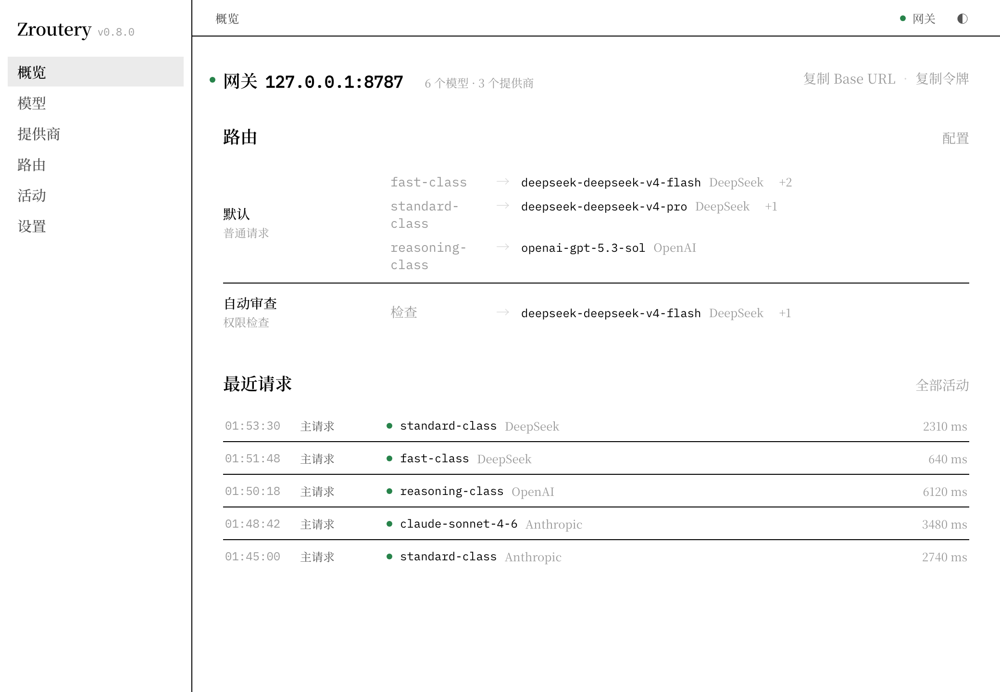
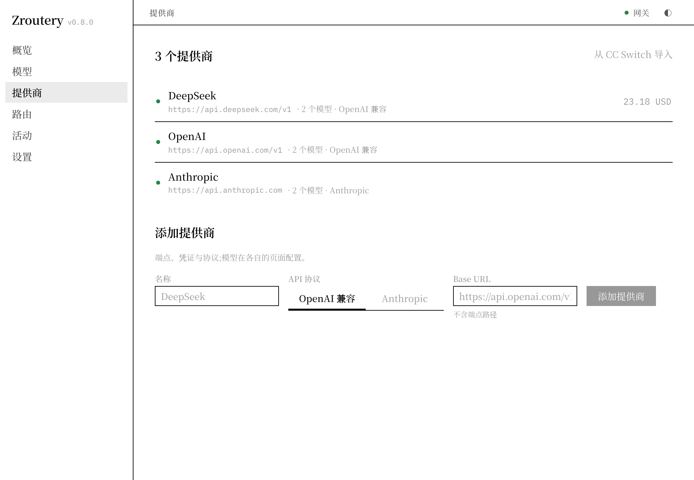
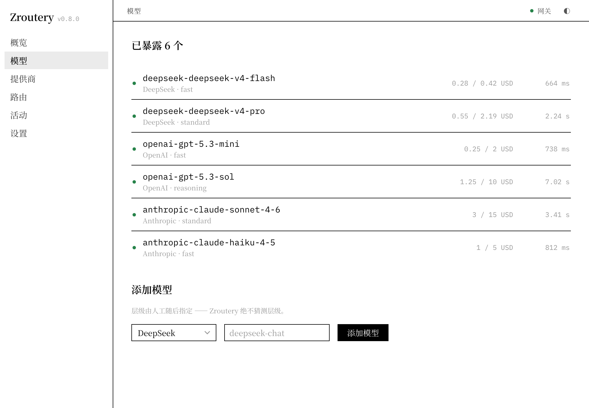
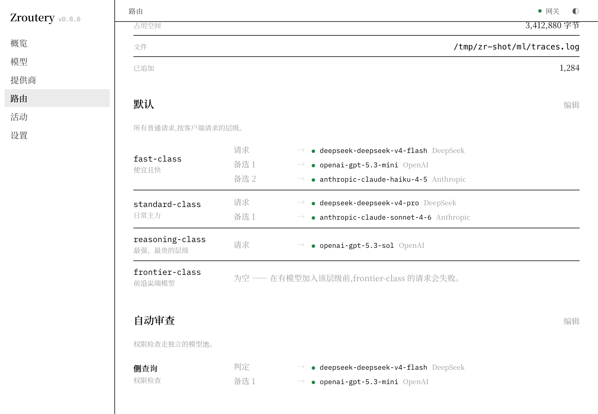
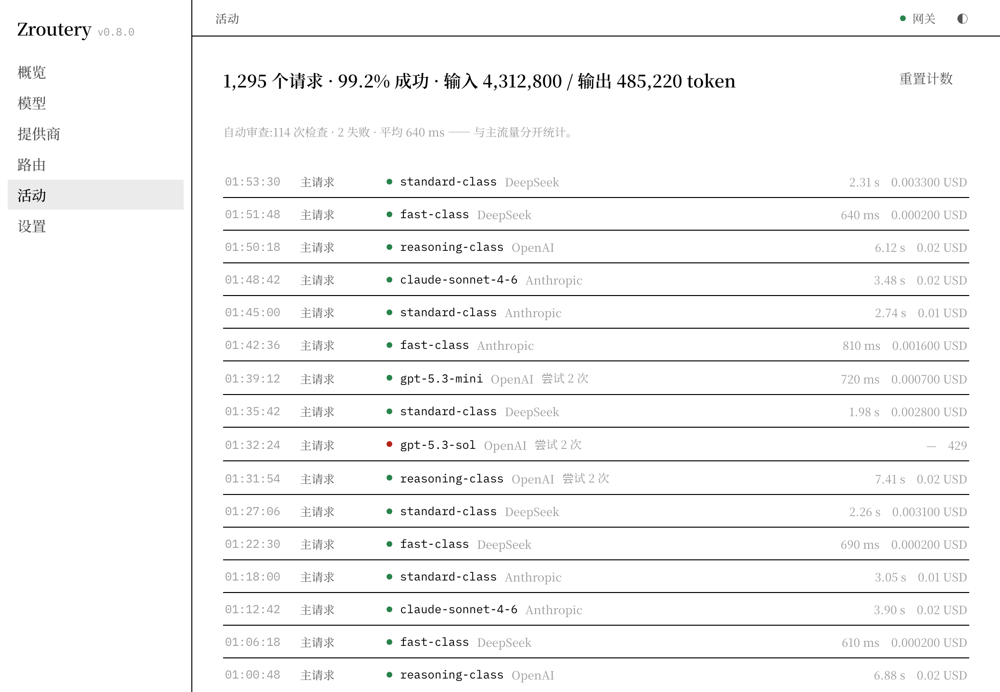
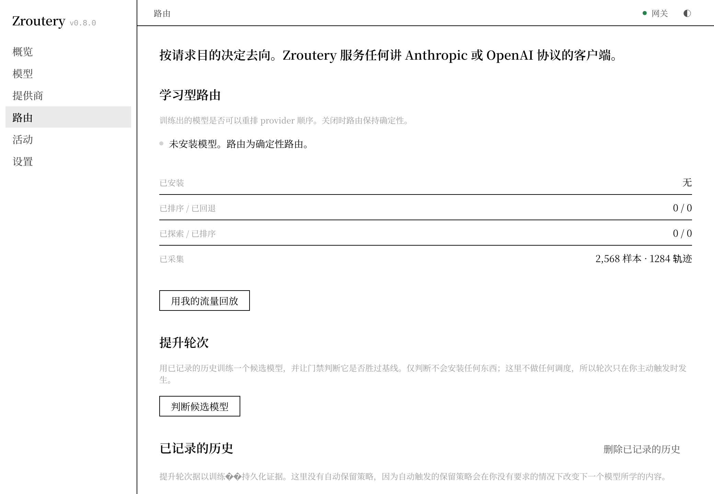

# Zroutery

English | [简体中文](README.zh-CN.md) | [繁體中文](README.zh-TW.md)

[](https://github.com/hemingtsai/Zroutery/actions/workflows/ci.yml)
[](https://github.com/hemingtsai/Zroutery/actions/workflows/packaging.yml)
[](https://github.com/hemingtsai/Zroutery/releases)
[](https://github.com/hemingtsai/Zroutery)
[](https://github.com/hemingtsai/Zroutery)
[](#platform-support)

Zroutery is a local LLM gateway: it connects multiple model providers behind a single local address and handles protocol translation, routing, budgets, and usage accounting in one place.

Clients can speak Anthropic, OpenAI Chat, OpenAI Responses, or Gemini; Claude Code, Codex, Chatbox, or any SDK just points at `http://127.0.0.1:8787`, and failed requests automatically fall back to the next model. On macOS and Windows it runs as a menu bar / tray app; you can also run the proxy without any UI.



## Features

- **Multi-protocol**: supports Anthropic, OpenAI Chat, OpenAI Responses, and Gemini client protocols; upstream providers currently support Anthropic and OpenAI-compatible.
- **Model tiers**: models are grouped into fast / standard / reasoning / frontier; clients just request `standard-class`, and the model actually used is decided by your priority order, routing policy, and upstream health.
- **Failover**: errors are classified to decide between retrying and switching models; repeated failures trip a per-model circuit breaker, and half-open probes detect recovery. Failover and breaker parameters are configurable.
- **Budgets**: daily / monthly limits per total, provider, or tier; over-budget requests can be rejected or downgraded to a cheaper tier. Ledgers persist across restarts.
- **Key security**: API keys are stored in the system credential store (macOS Keychain / Windows Credential Manager); the config file holds a reference, not the key. The one exception is a provider's `extra_headers`: that map is written into the config document, so never put a credential there.
- **Privacy**: request and response bodies are never persisted; records contain metadata only, and upstream error bodies are truncated before being written.

## Quick start

Requirements: Rust 1.90 (the minimum required by Tauri 2.12), Node 22, and pnpm 11.

```sh
rustup toolchain install 1.90.0
rustup override set 1.90.0     # optional: pin this directory
corepack enable                # provides pnpm
pnpm install

pnpm dev      # development mode
pnpm build    # macOS produces .app/.dmg; Windows produces .msi and an NSIS installer
```

The desktop app has no Dock icon; it lives in the menu bar / tray. That one menu opens the main window, starts and stops the gateway, copies the address and token, and quits. Closing the window does not quit the app — the proxy keeps running.

Proxy only, no UI:

```sh
cargo run -p zroutery-headless
```

In headless mode, keys are read from environment variables, e.g. `ZROUTERY_KEY_PROVIDER_DEEPSEEK=sk-...` (provider `provider:deepseek` maps to `ZROUTERY_KEY_PROVIDER_DEEPSEEK`). Point `ZROUTERY_CONFIG_DIR` at a custom config directory. To share usage records between multiple instances, point `ZROUTERY_RUNTIME_DB` at the same `runtime.sqlite3`.

## Setup

1. Add an upstream on the **Providers** page: name, protocol (OpenAI-compatible or Anthropic), Base URL, and API key. Keys go straight into the system credential store, not the config file. Bulk import from CC Switch is supported.

   

2. Fetch the model catalog on the provider details page and add the models you want to use.

3. Assign a tier to each model on the **Models** page. Models without a tier can still be called by their full id; they just don't participate in `*-class` routing, and the page keeps reminding you. Tier ids are customizable (`fast-class`, or Anthropic-style `haiku-class`, OpenAI-style `luna-class`) in Settings.

   

4. Order the candidates for each tier on the **Routing** page — by priority number by default, or by an election on measured latency and price — and set failover and circuit breaker parameters. Once ordered, the page lists each tier's candidates in the exact order routing will try them.

   

## Accounts and check-in

An account is a declaration on a provider: its panel token, an optional inference-key pool, and maintenance options. The Providers drawer edits the declaration; the **Accounts** page shows the runtime face — the last probe, the check-in phase, and why the scheduler did or did not act. Probing is manual and covers the enabled accounts. Requests do not route by account: the serving path resolves one credential per provider.

Check-in has two paths. **HTTP check-in** uses the panel's own API with the stored credential, with no browser. **Browser check-in** opens a headed browser with a per-account profile and reports its phase; it is the path for panels whose check-in is not a plain API call. **Token capture** mints a durable panel token when the panel does not expose one, stores it in the credential store and points the account at it; the capture view has no token field.

## NewAPI panels

A NewAPI provider can expose its panel from the provider details: announcements, group pricing, and an account selector. Reading the panel never changes routing prices; saving a price is a separate model edit. An unreachable panel is reported as a panel error, not as a routing failure.

## Cutover

Cutover moves an external client's configuration onto this gateway as a typed plan. Preview the plan and its fingerprint, apply it, and roll back to the captured snapshot if a step fails. The snapshot is written before the file is replaced, so an interrupted run is recoverable. A failed cutover with no snapshot offers no rollback.

## Takeover

Takeover writes only the managed gateway fields into a client's own configuration, records what it replaced, and restores those values on release. **Ready** shows a field-level diff; **conflict** asks which side wins; **degraded** explains what is not yet proven; **release** is the destructive step and asks for confirmation. Unlike cutover, takeover manages fields rather than replacing the whole file.

## Connecting clients

The gateway listens on `http://127.0.0.1:8787` by default; the port and bind address are configurable. Each protocol has its own endpoint:

| Client protocol | Endpoint |
| --- | --- |
| Anthropic Messages | `POST /v1/messages` |
| OpenAI Chat Completions | `POST /v1/chat/completions` |
| OpenAI Responses | `POST /v1/responses` |
| Gemini generateContent | `POST /v1/generateContent` |

Also available: `GET /v1/models` (lists all callable ids), `GET /v1/status`, and `GET /health` (the only unauthenticated endpoint). Authentication accepts `x-api-key` or `Authorization: Bearer`; copy the token from the "Gateway" menu in the top-right corner.

Claude Code:

```sh
export ANTHROPIC_BASE_URL=http://127.0.0.1:8787
export ANTHROPIC_AUTH_TOKEN=<paste token>
export ANTHROPIC_MODEL=standard-class
```

OpenAI-style clients:

```sh
export OPENAI_BASE_URL=http://127.0.0.1:8787/v1
export OPENAI_API_KEY=<paste token>
```

## Where data lives

| Content | Location | Notes |
| --- | --- | --- |
| Configuration | `config.json`: macOS at `~/Library/Application Support/app.zroutery.desktop/`, Windows at `%APPDATA%\app.zroutery.desktop\`; override with `ZROUTERY_CONFIG_DIR` | No provider key; the local gateway token and any `extra_headers` you add are stored here. If the file is corrupted, back it up and restart with defaults |
| API keys | System credential store (macOS Keychain / Windows Credential Manager) | Only `key_ref` appears in the config |
| Budget ledger | `spend.json` in the config directory | Written periodically and on exit |
| Runtime store | `runtime.sqlite3` in the config directory, or `ZROUTERY_RUNTIME_DB` | Usage history, imported history and accounting facts |
| Learning traces | `ml/traces.jsonl` in the config directory | Appended only while shadow evaluation or a promoted model is active; cleared explicitly |
| Request records, health, latency stats, Responses sessions | In memory | Bounded; cleared on restart |

## Platform support

- **macOS 11+**: ships `.app` and `.dmg`; menu bar resident; launch-at-login via LaunchAgent. Ad-hoc signing, no notarization.
- **Windows**: ships `.msi` and NSIS installers; CI installs, reinstalls, and uninstalls them nightly to verify the installers.
- **Linux**: not a supported release target. There is no Linux packaging target; the credential-store dependency for Linux is compiled in `src-tauri/Cargo.toml`, so a source build may run, but it is not tested or shipped.
- **Upstream**: Anthropic and OpenAI-compatible only for now; Gemini and Responses are client-entry protocols only, not upstreams yet.

## Statistics

The **Activity** page lists each request's entry protocol, the model actually used, attempt count, latency, tokens, and cost, and aggregates success rate and spend per model; circuit breaker counters can be reset individually. Moderation-side requests are tracked separately from main traffic.



Budgets are configured on the **Settings** page, which shows usage and limits side by side.

## Learning-based routing

Desktop builds include the `ml` module, disabled by default: no collection, no training, no effect on routing. With shadow mode enabled, each request additionally records one counterfactual entry (who would win if models were scored); actual routing is unaffected, and promotion runs only when triggered manually in the UI.



## Development

```sh
pnpm test                                 # cargo test --workspace
pnpm smoke                                # end-to-end tests against a fake upstream
pnpm test:layout                          # UI layout regression
python3 scripts/ui_interaction_test.py    # UI interaction regression (mock IPC + headless Chromium)
cargo clippy --workspace --all-features --all-targets -- -D warnings
cargo fmt --all -- --check
```

Code layout: `crates/zroutery-core` is the engine, with no GUI dependency; `src-tauri` is the desktop shell (tray, credential store, CC Switch import); `crates/zroutery-headless` is the headless proxy, with `--elect`, `--balances`, and `--experiment` subcommands; `ui/` is the React dashboard (English, Simplified Chinese and Traditional Chinese); `scripts/` holds the verification scripts.

Commit messages follow Conventional Commits and are validated by CI. Architecture decisions and stage records live in `docs/development/`; read `CONTRIBUTING.md` and `AGENTS.md` before making changes.

## License

MIT (see [LICENSE](LICENSE) and the `license` field in `Cargo.toml`).

## Fact sources

- Rust minimum and Node/pnpm pins: `Cargo.toml::rust-version`, `package.json::packageManager`, `.github/workflows/ci.yml::setup-node`.
- Default bind address, port and body limit: `crates/zroutery-core/src/config/server.rs::ServerConfig`.
- HTTP routes: `crates/zroutery-core/src/server/handlers.rs::build_app`.
- Bundle targets: `src-tauri/tauri.conf.json::bundle`.
- Config file and gateway token: `src-tauri/src/store.rs::FILE_NAME`, `src-tauri/src/store.rs::generate_token`.
- Linux credential dependency: `src-tauri/Cargo.toml::keyring`.
- Data locations: `src-tauri/src/platform.rs::default_config_dir`, `crates/zroutery-core/src/runtime_store.rs::RuntimeStore`.

The canonical owner of each repeated fact is [config.md](docs/development/reference/config.md) for bind/port, [protocol.md](docs/development/reference/protocol.md) for dialects, and [routing-data.md](docs/development/reference/routing-data.md) for data locations. This guide is a pointer; the reference wins.
