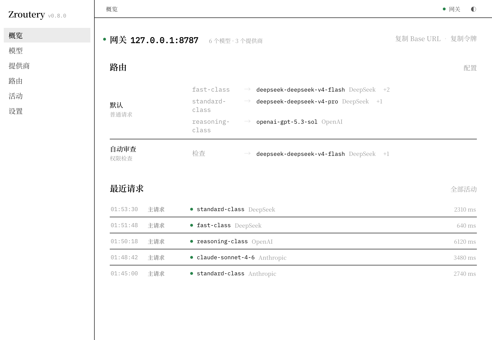
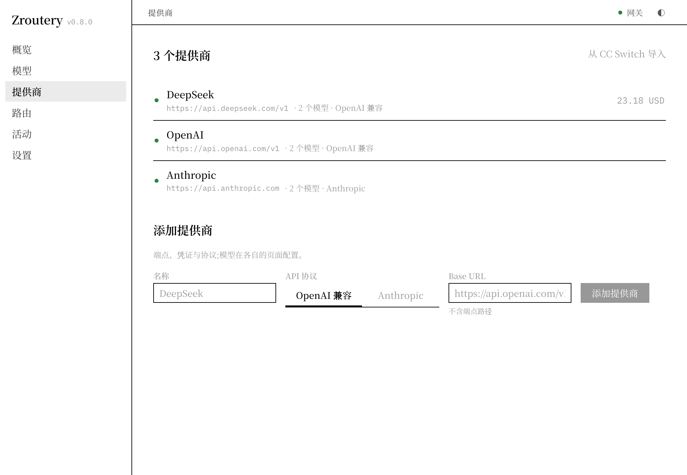
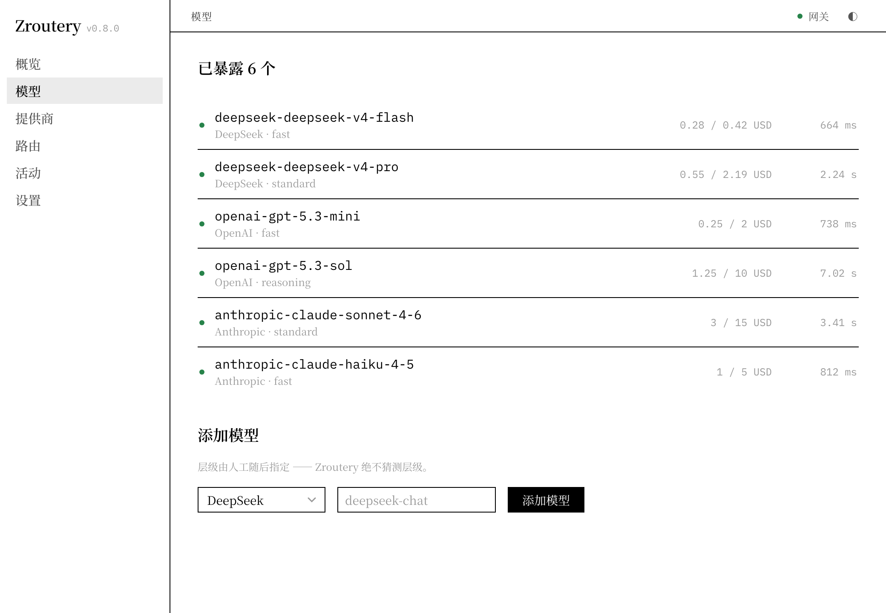
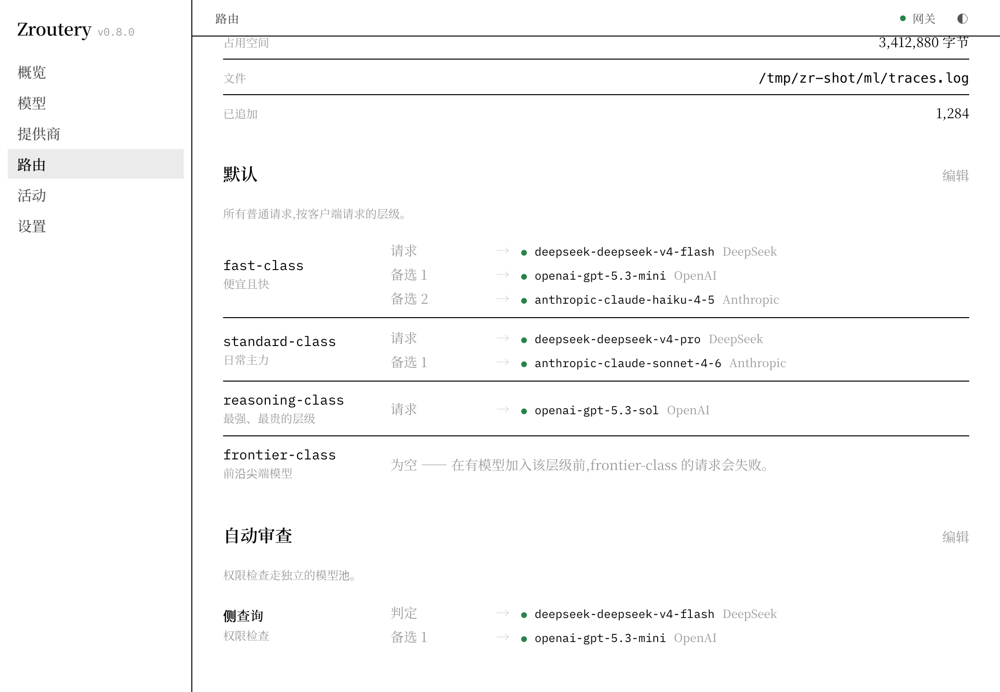
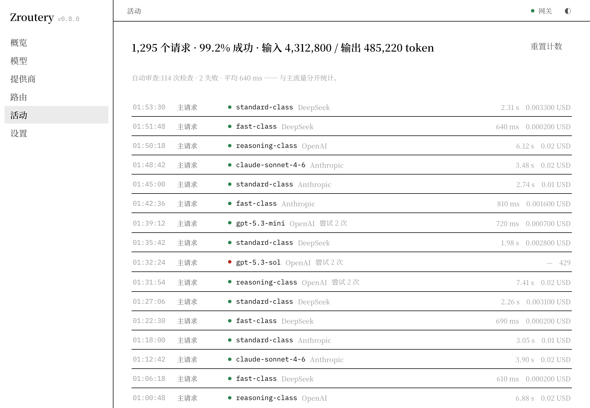
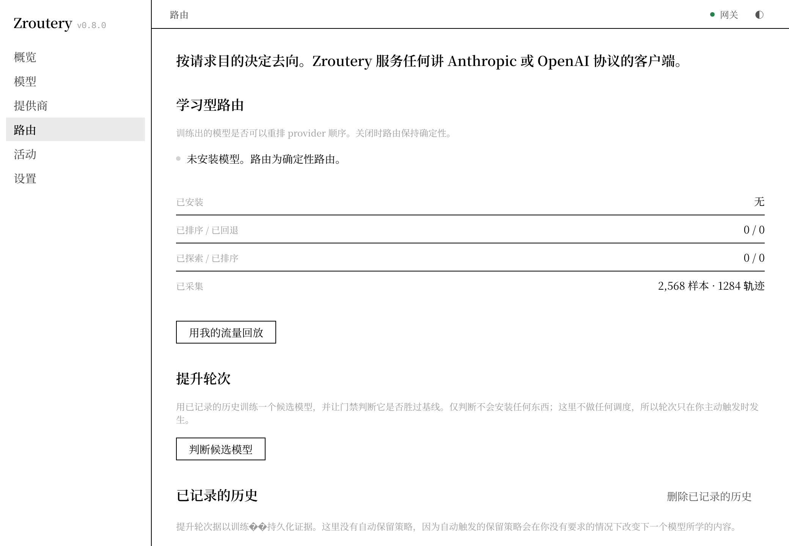

# Zroutery

[English](README.md) | 简体中文 | [繁體中文](README.zh-TW.md)

[](https://github.com/hemingtsai/Zroutery/actions/workflows/ci.yml)
[](https://github.com/hemingtsai/Zroutery/actions/workflows/packaging.yml)
[](https://github.com/hemingtsai/Zroutery/releases)
[](https://github.com/hemingtsai/Zroutery)
[](https://github.com/hemingtsai/Zroutery)
[](#平台支持)

Zroutery 是一个本地 LLM 网关：把多家模型供应商接到同一个本地地址，统一处理协议转换、路由、预算和用量统计。

客户端用哪种协议都行——Anthropic、OpenAI Chat、OpenAI Responses、Gemini；Claude Code、Codex、Chatbox 或任意 SDK 指向 `http://127.0.0.1:8787` 即可使用，请求失败会自动切换到下一个模型。macOS 和 Windows 上是常驻菜单栏 / 托盘的桌面应用，也可以不开界面，只跑代理进程。



## 功能

- **多协议**：支持 Anthropic、OpenAI Chat、OpenAI Responses、Gemini 四种客户端协议；上游支持 Anthropic、OpenAI 兼容（Chat Completions 或 Responses）以及 OpenCode Zen/Console。
- **主题与插件**：仪表盘内置数据主题（token 来源固定），桌面构建包含按能力授权的插件宿主；未启用 `plugin` feature 的构建不会激活任何插件声明。社区中继包通过 manifest 声明静态的客户端观感身份头与自己的版本分段基座，插件管理页可不重启重载接线。
- **模型分档**：模型分为 fast / standard / reasoning / frontier 四档，客户端只写 `standard-class`，由优先级、路由策略和上游健康状态决定实际使用的模型。
- **失败转移**：按错误类型决定重试或切换模型；模型连续失败触发熔断，熔断期间通过半开探针探测恢复，失败转移次数和熔断参数均可配置。
- **预算控制**：按总量、供应商或档位设置日 / 月上限，超限后可拒绝请求或自动降级到更便宜的档位；账本落盘，重启不丢。
- **密钥安全**：API key 存入系统凭据库（macOS 钥匙串 / Windows 凭据管理器），配置文件只保存引用，不出现密钥本身。唯一例外是供应商的 `extra_headers`：该映射会写进配置文件，不要把凭据放在那里。
- **隐私**：请求和回复正文不落盘，请求记录只保存元数据，上游错误正文写入前截断。

## 快速开始

环境：Rust 1.90（Tauri 2.12 要求的最低版本）、Node 22 和 pnpm 11。

```sh
rustup toolchain install 1.90.0
rustup override set 1.90.0     # 可选：固定本目录的版本
corepack enable                # 提供 pnpm
pnpm install

pnpm dev      # 开发模式
pnpm build    # macOS 出 .app/.dmg，Windows 出 .msi 和 NSIS 安装器
```

桌面版启动后没有 Dock 图标，只有菜单栏 / 托盘里的一份菜单：打开主窗口、启停网关、复制地址和 token，退出也在里面。关掉窗口程序不退出，代理继续运行。

不开界面、只跑代理：

```sh
cargo run -p zroutery-headless
```

无界面模式下 key 从环境变量读取，比如 `ZROUTERY_KEY_PROVIDER_DEEPSEEK=sk-...`（供应商 `provider:deepseek` 对应这个变量名）。配置目录用 `ZROUTERY_CONFIG_DIR` 指定；多个实例要共用用量记录时，让 `ZROUTERY_RUNTIME_DB` 指向同一个 `runtime.sqlite3`。

## 配置

1. **供应商**页添加上游：填名字、协议（Anthropic、OpenAI 兼容、OpenCode Zen/Console 或决策模型）、Base URL，粘贴 API key。key 直接存入系统凭据库，不进配置文件。支持从 CC Switch 批量导入。

   

2. 在供应商详情里拉取一次模型目录，把要用的模型加进来。

3. **模型**页给每个模型定档。没有定档的模型仍可以用完整 id 调用，只是不参与 `*-class` 路由，页面会持续提示。档位名称可以自定义（`fast-class`、`haiku-class`、`luna-class` 都可以），在设置里修改。

   

4. **路由**页给每个档位排优先级，默认按数字，也可以改为按实测延迟和价格选举；同时设置失败转移次数和熔断参数。排好后页面按实际尝试顺序显示每档的候选模型。

   

## 接上客户端

网关默认监听 `http://127.0.0.1:8787`，端口和监听地址都可以改。四种协议各有入口：

| 客户端协议 | 入口 |
| --- | --- |
| Anthropic Messages | `POST /v1/messages` |
| OpenAI Chat Completions | `POST /v1/chat/completions` |
| OpenAI Responses | `POST /v1/responses` |
| Gemini generateContent | `POST /v1/generateContent` |

另外有 `GET /v1/models`（列出所有可调用的 id）、`GET /v1/status` 和 `GET /health`（唯一不需要鉴权的接口）。鉴权支持 `x-api-key` 和 `Authorization: Bearer`，token 在「网关」菜单里复制。

Claude Code：

```sh
export ANTHROPIC_BASE_URL=http://127.0.0.1:8787
export ANTHROPIC_AUTH_TOKEN=<粘贴 token>
export ANTHROPIC_MODEL=standard-class
```

使用服务端 auto 模式时，开启 **自动审查** 和 **Claude Code 服务端 auto 审核**，
并向模型池加入可信的审核模型。原生审核结果原样保留；其他上游由本池审核，逐工具结果
随流式终态返回。审核模型会看到会话及工具输入，实际用量单独记账。这是客户端协议兼容，
不代表官方私有分类器或官方免费审核资格。
详见 [Auto 审核](docs/development/reference/request-purpose.md#embedded-claude-code-auto-review)。

OpenAI 系客户端：

```sh
export OPENAI_BASE_URL=http://127.0.0.1:8787/v1
export OPENAI_API_KEY=<粘贴 token>
```

## 数据放在哪

| 内容 | 位置 | 说明 |
| --- | --- | --- |
| 配置 | `config.json`：macOS 在 `~/Library/Application Support/app.zroutery.desktop/`，Windows 在 `%APPDATA%\app.zroutery.desktop\`，可用 `ZROUTERY_CONFIG_DIR` 覆盖 | 不含供应商密钥；本地网关 token 和自定义 `extra_headers` 会存在这里。文件损坏时先备份一份，再用默认值启动 |
| API key | 系统凭据库（macOS 钥匙串 / Windows 凭据管理器） | 配置里只有 `key_ref` |
| 预算账本 | 配置目录下的 `spend.json` | 定时和退出时写盘 |
| 运行时库 | 配置目录下的 `runtime.sqlite3`，或 `ZROUTERY_RUNTIME_DB` | 用量历史、导入历史和记账事实 |
| 学习轨迹 | 配置目录下的 `ml/traces.jsonl` | 仅在影子评估或已提升模型运行时追加；由操作者显式清空 |
| 请求记录、健康、延迟统计、Responses 会话 | 内存 | 有上限，重启清空 |

## 平台支持

- **macOS 11+**：提供 `.app` 和 `.dmg`；常驻菜单栏；开机启动通过 LaunchAgent 实现。签名是 ad-hoc，没有公证。
- **Windows**：提供 `.msi` 和 NSIS 安装器；CI 每晚会实际安装、重装、卸载一次安装器来验证。
- **Linux**：不是支持的发布目标。没有 Linux 打包配置；`src-tauri/Cargo.toml` 中确实包含 Linux 凭据库依赖，因此源码构建或许能运行，但未经验证、也不随版本发布。
- **上游**：Anthropic、OpenAI 兼容（Chat Completions 或 Responses）、OpenCode Zen/Console，以及只回答判定问题、不做对话的决策模型；Gemini 只能作为客户端入口协议，不能作为上游。

## 统计

**活动**页列出每个请求的入口协议、实际使用的模型、尝试次数、延迟、token 和花费，并按模型汇总成功率和支出；熔断计数可以单独清零。自动审查产生的侧请求单独统计，不和主流量混在一起。



预算在**设置**页配置，页面上同时显示已用量和限额。

## 学习型路由

桌面构建包含 `ml` 模块，但默认关闭：不采集、不训练、不影响选路。开启影子模式后，每个请求会多记录一条对照数据（按模型打分会选谁），实际路由不受影响。应用晋升模型由操作者触发——界面、桌面 IPC 或已认证的 `/v1/ml/promote` 接口——没有定时任务。



## 开发

```sh
pnpm test                                 # cargo test --workspace
pnpm smoke                                # 端到端测试（假上游）
pnpm test:layout                          # UI 布局回归
python3 scripts/ui_interaction_test.py    # UI 交互回归（假 IPC + 无头 Chromium）
cargo clippy --workspace --all-features --all-targets -- -D warnings
cargo fmt --all -- --check
```

代码结构：`crates/zroutery-core` 是引擎，不依赖 GUI；`src-tauri` 是桌面外壳（托盘、凭据库、CC Switch 导入）；`crates/zroutery-headless` 是无界面代理，带 `--elect`、`--balances`、`--experiment` 子命令；`ui/` 是 React 仪表盘，支持英文、简体中文、繁体中文；`scripts/` 存放验证脚本。

提交信息按 Conventional Commits 书写，CI 会逐条检查。架构决策和各阶段的记录在 `docs/development/`；改代码前先看 `CONTRIBUTING.md` 和 `AGENTS.md`。

## 许可

MIT（见 `Cargo.toml` 的 `license`）。

## 事实来源

- Rust 最低版本与 Node/pnpm 固定版本：`Cargo.toml::rust-version`、`package.json::packageManager`、`package.json::scripts`、`.github/workflows/ci.yml::setup-node`。
- Rust 依赖固定版本：`crates/zroutery-core/Cargo.toml::dependencies`、`crates/zroutery-plugin-host/Cargo.toml::dependencies`、`src-tauri/Cargo.toml::dependencies`；解析后的版本记录在 `Cargo.lock`。
- 默认监听地址、端口与请求体上限：`crates/zroutery-core/src/config/server.rs::ServerConfig`。
- HTTP 路由：`crates/zroutery-core/src/server/handlers.rs::build_app`。
- 上游协议类型与 API 端面：`crates/zroutery-core/src/config/provider.rs::ProviderKind`、`crates/zroutery-core/src/config/provider.rs::ApiSurface`、`crates/zroutery-core/src/config/provider.rs::ProviderKind::is_decision`、`crates/zroutery-core/src/config/registry.rs::ProviderConfig::dialect`。
- 上游客户端身份：`crates/zroutery-core/src/config/provider.rs::AUTO_IDENTITY_HEADERS`、`crates/zroutery-core/src/config/provider.rs::resolve_client_identity`。
- 主题与插件端面：`crates/zroutery-plugin-api/src/capability.rs::Capability`、`crates/zroutery-plugin-api/src/manifest.rs::PluginManifestV1`、`crates/zroutery-plugin-api/src/options.rs::OptionsSchemaV1`、`crates/zroutery-core/src/config/plugin.rs::PluginInstanceConfig`、`ui/src/themes/registry.ts`、`scripts/plugin_theme_test.py`、`scripts/theme_sources/manifest.json`。
- 打包目标：`src-tauri/tauri.conf.json::bundle`。
- 配置文件与网关 token：`src-tauri/src/store.rs::FILE_NAME`、`src-tauri/src/store.rs::generate_token`。
- Linux 凭据依赖：`src-tauri/Cargo.toml::keyring`。
- 数据位置：`src-tauri/src/platform.rs::default_config_dir`、`crates/zroutery-core/src/runtime_store.rs::RuntimeStore`。
- 服务端 auto 审核：`crates/zroutery-core/src/server/pipeline/safeguards/mod.rs::ReviewContext`、`ui/src/pages/routing/AutoModeDrawer.tsx::AutoModeDrawer`。
- 数据位置：`src-tauri/src/platform.rs::default_config_dir`、`crates/zroutery-core/src/runtime_store.rs::RuntimeStore`、`crates/zroutery-core/src/runtime_store.rs::RuntimeStore::usage_snapshot`。

每个重复事实的权威归属：[config.md](docs/development/reference/config.md) 负责监听地址/端口，[protocol.md](docs/development/reference/protocol.md) 负责协议，[routing-data.md](docs/development/reference/routing-data.md) 负责数据位置。本指南只是指针；冲突时以 reference 为准。
# Zroutery

[English](README.md) | 简体中文 | [繁體中文](README.zh-TW.md)

[](https://github.com/hemingtsai/Zroutery/actions/workflows/ci.yml)
[](https://github.com/hemingtsai/Zroutery/actions/workflows/packaging.yml)
[](https://github.com/hemingtsai/Zroutery/releases)
[](https://github.com/hemingtsai/Zroutery)
[](https://github.com/hemingtsai/Zroutery)
[](#平台支持)

Zroutery 是一个本地 LLM 网关：把多家模型供应商接到同一个本地地址，统一处理协议转换、路由、预算和用量统计。

客户端用哪种协议都行——Anthropic、OpenAI Chat、OpenAI Responses、Gemini；Claude Code、Codex、Chatbox 或任意 SDK 指向 `http://127.0.0.1:8787` 即可使用，请求失败会自动切换到下一个模型。macOS 和 Windows 上是常驻菜单栏 / 托盘的桌面应用，也可以不开界面，只跑代理进程。


## 功能

- **多协议**：支持 Anthropic、OpenAI Chat、OpenAI Responses、Gemini 四种客户端协议；上游支持 Anthropic、OpenAI 兼容（Chat Completions 或 Responses）以及 OpenCode Zen/Console。
- **主题与插件**：仪表盘内置数据主题（token 来源固定），桌面构建包含按能力授权的插件宿主；未启用 `plugin` feature 的构建不会激活任何插件声明。社区中继包通过 manifest 声明静态的客户端观感身份头与自己的版本分段基座，插件管理页可不重启重载接线。
- **模型分档**：模型分为 fast / standard / reasoning / frontier 四档，客户端只写 `standard-class`，由优先级、路由策略和上游健康状态决定实际使用的模型。
- **失败转移**：按错误类型决定重试或切换模型；模型连续失败触发熔断，熔断期间通过半开探针探测恢复，失败转移次数和熔断参数均可配置。
- **预算控制**：按总量、供应商或档位设置日 / 月上限，超限后可拒绝请求或自动降级到更便宜的档位；账本落盘，重启不丢。
- **密钥安全**：API key 存入系统凭据库（macOS 钥匙串 / Windows 凭据管理器），配置文件只保存引用，不出现密钥本身。唯一例外是供应商的 `extra_headers`：该映射会写进配置文件，不要把凭据放在那里。
- **隐私**：请求和回复正文不落盘，请求记录只保存元数据，上游错误正文写入前截断。

## 快速开始

环境：Rust 1.90（Tauri 2.12 要求的最低版本）、Node 22 和 pnpm 11；Tauri CLI 与 API 的版本固定在 `package.json` 和 `ui/package.json` 中。

```sh
rustup toolchain install 1.90.0
rustup override set 1.90.0     # 可选：固定本目录的版本
corepack enable                # 提供 pnpm
pnpm install

pnpm dev      # 开发模式
pnpm build    # macOS 出 .app/.dmg，Windows 出 .msi 和 NSIS 安装器
```

桌面版启动后没有 Dock 图标，只有菜单栏 / 托盘里的一份菜单：打开主窗口、启停网关、复制地址和 token，退出也在里面。关掉窗口程序不退出，代理继续运行。

不开界面、只跑代理：

```sh
cargo run -p zroutery-headless
```

无界面模式下 key 从环境变量读取，比如 `ZROUTERY_KEY_PROVIDER_DEEPSEEK=sk-...`（供应商 `provider:deepseek` 对应这个变量名）。配置目录用 `ZROUTERY_CONFIG_DIR` 指定；多个实例要共用用量记录时，让 `ZROUTERY_RUNTIME_DB` 指向同一个 `runtime.sqlite3`。

## 配置

1. **供应商**页添加上游：填名字、协议（Anthropic、OpenAI 兼容、OpenCode Zen/Console 或决策模型）、Base URL，粘贴 API key。key 直接存入系统凭据库，不进配置文件。支持从 CC Switch 批量导入。

   

2. 在供应商详情里拉取一次模型目录，把要用的模型加进来。

3. **模型**页给每个模型定档。没有定档的模型仍可以用完整 id 调用，只是不参与 `*-class` 路由，页面会持续提示。档位名称可以自定义（`fast-class`、`haiku-class`、`luna-class` 都可以），在设置里修改。

   

4. **路由**页给每个档位排优先级，默认按数字，也可以改为按实测延迟和价格选举；同时设置失败转移次数和熔断参数。排好后页面按实际尝试顺序显示每档的候选模型。

   

## 接上客户端

网关默认监听 `http://127.0.0.1:8787`，端口和监听地址都可以改。四种协议各有入口：

| 客户端协议 | 入口 |
| --- | --- |
| Anthropic Messages | `POST /v1/messages` |
| OpenAI Chat Completions | `POST /v1/chat/completions` |
| OpenAI Responses | `POST /v1/responses` |
| Gemini generateContent | `POST /v1/generateContent` |

另外有 `GET /v1/models`（列出所有可调用的 id）、`GET /v1/status` 和 `GET /health`（唯一不需要鉴权的接口）。鉴权支持 `x-api-key` 和 `Authorization: Bearer`，token 在「网关」菜单里复制。

Claude Code：

```sh
export ANTHROPIC_BASE_URL=http://127.0.0.1:8787
export ANTHROPIC_AUTH_TOKEN=<粘贴 token>
export ANTHROPIC_MODEL=standard-class
```

OpenAI 系客户端：

```sh
export OPENAI_BASE_URL=http://127.0.0.1:8787/v1
export OPENAI_API_KEY=<粘贴 token>
```

## 数据放在哪

| 内容 | 位置 | 说明 |
| --- | --- | --- |
| 配置 | `config.json`：macOS 在 `~/Library/Application Support/app.zroutery.desktop/`，Windows 在 `%APPDATA%\app.zroutery.desktop\`，可用 `ZROUTERY_CONFIG_DIR` 覆盖 | 不含供应商密钥；本地网关 token 和自定义 `extra_headers` 会存在这里。文件损坏时先备份一份，再用默认值启动 |
| API key | 系统凭据库（macOS 钥匙串 / Windows 凭据管理器） | 配置里只有 `key_ref` |
| 预算账本 | 配置目录下的 `spend.json` | 定时和退出时写盘 |
| 运行时库 | 配置目录下的 `runtime.sqlite3`，或 `ZROUTERY_RUNTIME_DB` | 用量历史、导入历史和记账事实 |
| 学习轨迹 | 配置目录下的 `ml/traces.jsonl` | 仅在影子评估或已提升模型运行时追加；由操作者显式清空 |
| 请求记录、健康、延迟统计、Responses 会话 | 内存 | 有上限，重启清空 |

## 平台支持

- **macOS 11+**：提供 `.app` 和 `.dmg`；常驻菜单栏；开机启动通过 LaunchAgent 实现。签名是 ad-hoc，没有公证。
- **Windows**：提供 `.msi` 和 NSIS 安装器；CI 每晚会实际安装、重装、卸载一次安装器来验证。
- **Linux**：不是支持的发布目标。没有 Linux 打包配置；`src-tauri/Cargo.toml` 中确实包含 Linux 凭据库依赖，因此源码构建或许能运行，但未经验证、也不随版本发布。
- **上游**：Anthropic、OpenAI 兼容（Chat Completions 或 Responses）、OpenCode Zen/Console，以及只回答判定问题、不做对话的决策模型；Gemini 只能作为客户端入口协议，不能作为上游。

## 统计

**活动**页列出每个请求的入口协议、实际使用的模型、尝试次数、延迟、token 和花费，并按模型汇总成功率和支出；熔断计数可以单独清零。自动审查产生的侧请求单独统计，不和主流量混在一起。


预算在**设置**页配置，页面上同时显示已用量和限额。

## 学习型路由

桌面构建包含 `ml` 模块，但默认关闭：不采集、不训练、不影响选路。开启影子模式后，每个请求会多记录一条对照数据（按模型打分会选谁），实际路由不受影响。应用晋升模型由操作者触发——界面、桌面 IPC 或已认证的 `/v1/ml/promote` 接口——没有定时任务。


## 开发

```sh
pnpm test                                 # cargo test --workspace
pnpm smoke                                # 端到端测试（假上游）
pnpm test:layout                          # UI 布局回归
python3 scripts/ui_interaction_test.py    # UI 交互回归（假 IPC + 无头 Chromium）
cargo clippy --workspace --all-features --all-targets -- -D warnings
cargo fmt --all -- --check
```

代码结构：`crates/zroutery-core` 是引擎，不依赖 GUI；`src-tauri` 是桌面外壳（托盘、凭据库、CC Switch 导入）；`crates/zroutery-headless` 是无界面代理，带 `--elect`、`--balances`、`--experiment` 子命令；`ui/` 是 React 仪表盘，支持英文、简体中文、繁体中文；`scripts/` 存放验证脚本。

提交信息按 Conventional Commits 书写，CI 会逐条检查。架构决策和各阶段的记录在 `docs/development/`；改代码前先看 `CONTRIBUTING.md` 和 `AGENTS.md`。

## 许可

MIT（见 `Cargo.toml` 的 `license`）。

## 事实来源

- Rust 最低版本与 Node/pnpm 固定版本：`Cargo.toml::rust-version`、`package.json::packageManager`、`package.json::scripts`、`.github/workflows/ci.yml::setup-node`。
- Rust 依赖固定版本：`crates/zroutery-core/Cargo.toml::dependencies`、`crates/zroutery-plugin-host/Cargo.toml::dependencies`、`src-tauri/Cargo.toml::dependencies`；解析后的版本记录在 `Cargo.lock`。
- 默认监听地址、端口与请求体上限：`crates/zroutery-core/src/config/server.rs::ServerConfig`。
- HTTP 路由：`crates/zroutery-core/src/server/handlers.rs::build_app`。
- 上游协议类型与 API 端面：`crates/zroutery-core/src/config/provider.rs::ProviderKind`、`crates/zroutery-core/src/config/provider.rs::ApiSurface`、`crates/zroutery-core/src/config/provider.rs::ProviderKind::is_decision`、`crates/zroutery-core/src/config/registry.rs::ProviderConfig::dialect`。
- 上游客户端身份：`crates/zroutery-core/src/config/provider.rs::AUTO_IDENTITY_HEADERS`、`crates/zroutery-core/src/config/provider.rs::resolve_client_identity`。
- 主题与插件端面：`crates/zroutery-plugin-api/src/capability.rs::Capability`、`crates/zroutery-plugin-api/src/manifest.rs::PluginManifestV1`、`crates/zroutery-core/src/config/plugin.rs::PluginInstanceConfig`、`ui/src/themes/registry.ts`、`scripts/plugin_theme_test.py`、`scripts/theme_sources/manifest.json`。
- 打包目标：`src-tauri/tauri.conf.json::bundle`。
- 配置文件与网关 token：`src-tauri/src/store.rs::FILE_NAME`、`src-tauri/src/store.rs::generate_token`。
- Linux 凭据依赖：`src-tauri/Cargo.toml::keyring`。
- 数据位置：`src-tauri/src/platform.rs::default_config_dir`、`crates/zroutery-core/src/runtime_store.rs::RuntimeStore`。

每个重复事实的权威归属：[config.md](docs/development/reference/config.md) 负责监听地址/端口，[protocol.md](docs/development/reference/protocol.md) 负责协议，[routing-data.md](docs/development/reference/routing-data.md) 负责数据位置。本指南只是指针；冲突时以 reference 为准。
