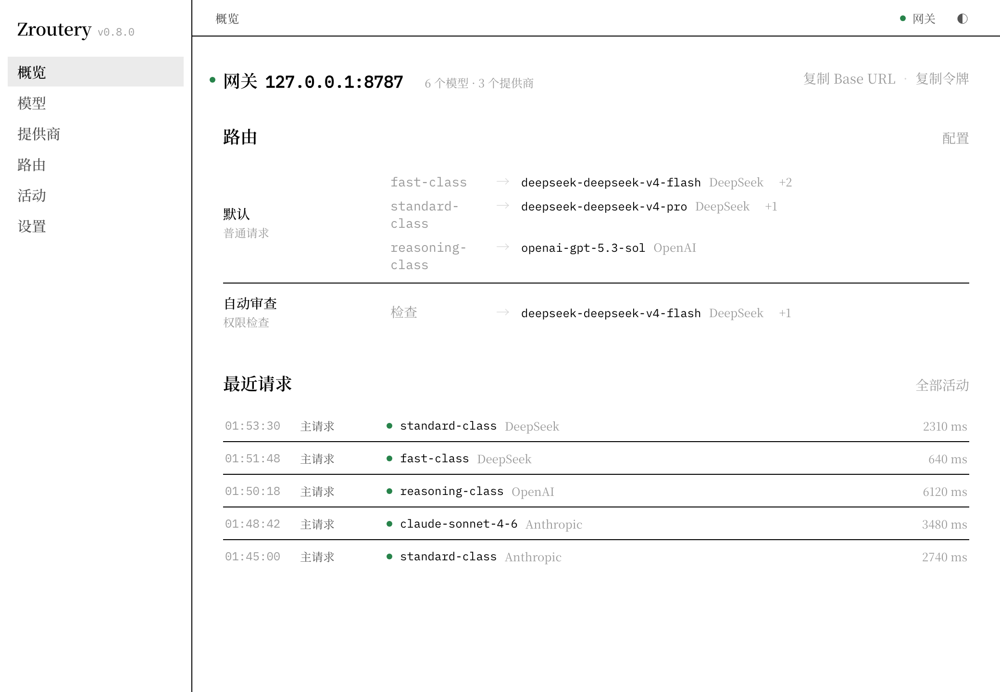
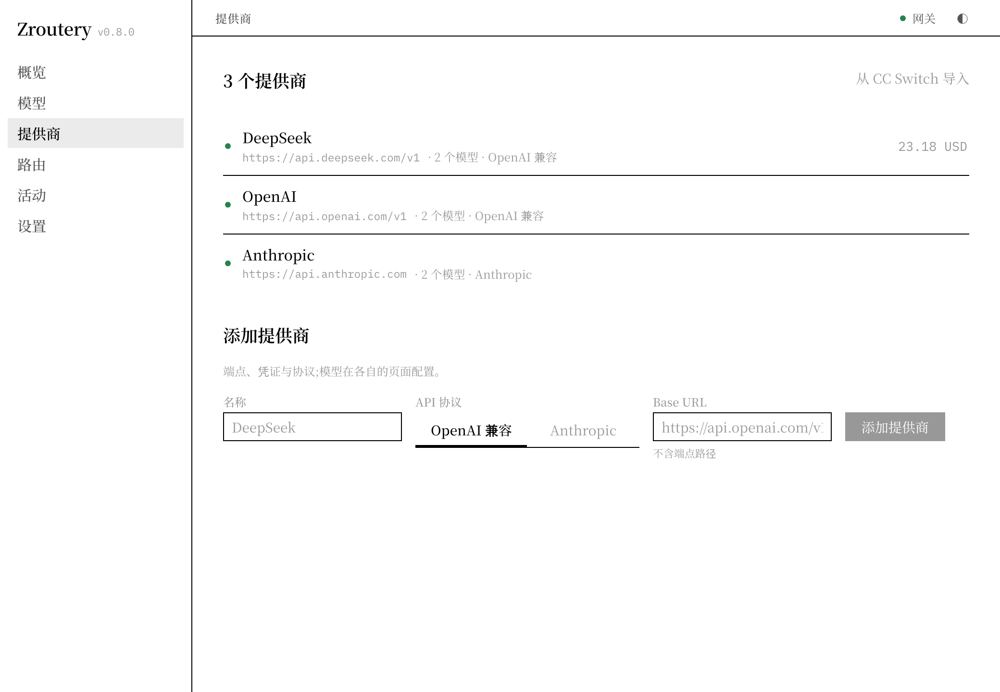
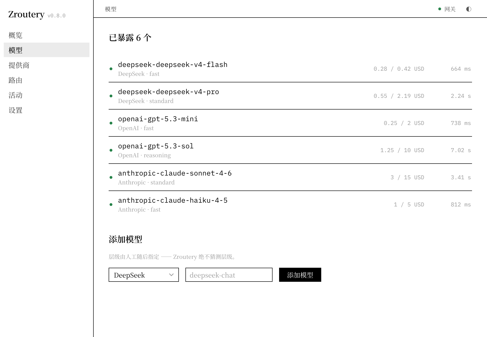
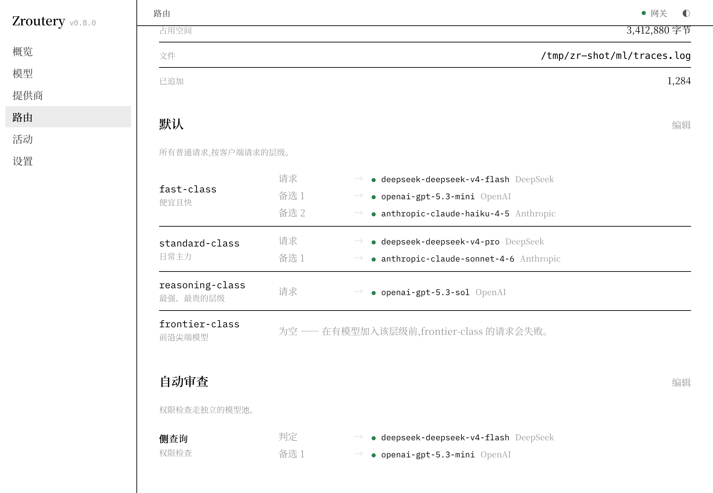
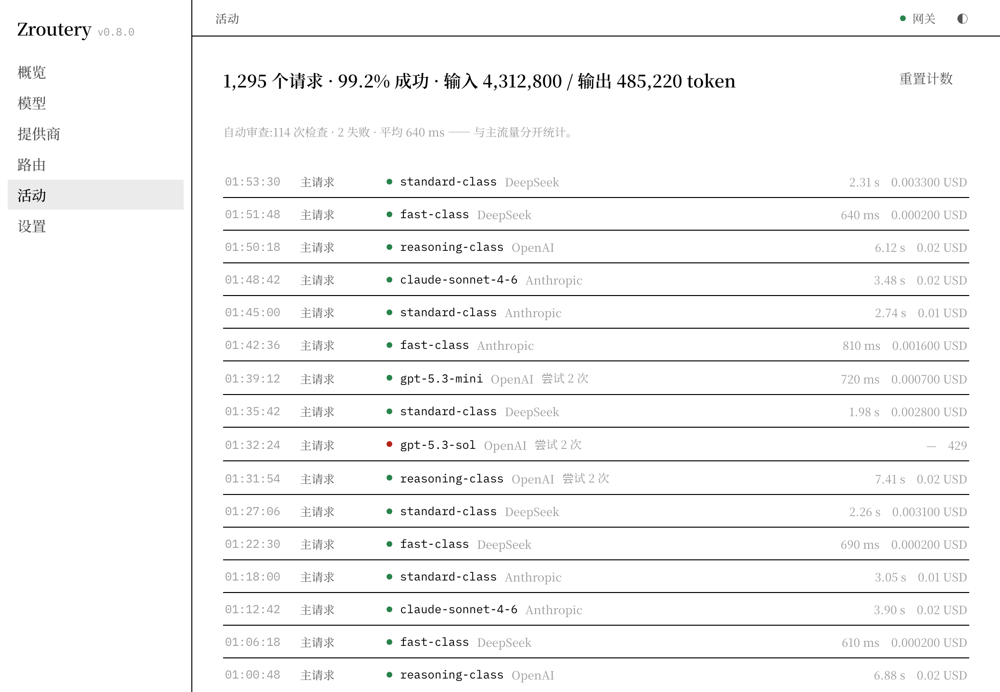
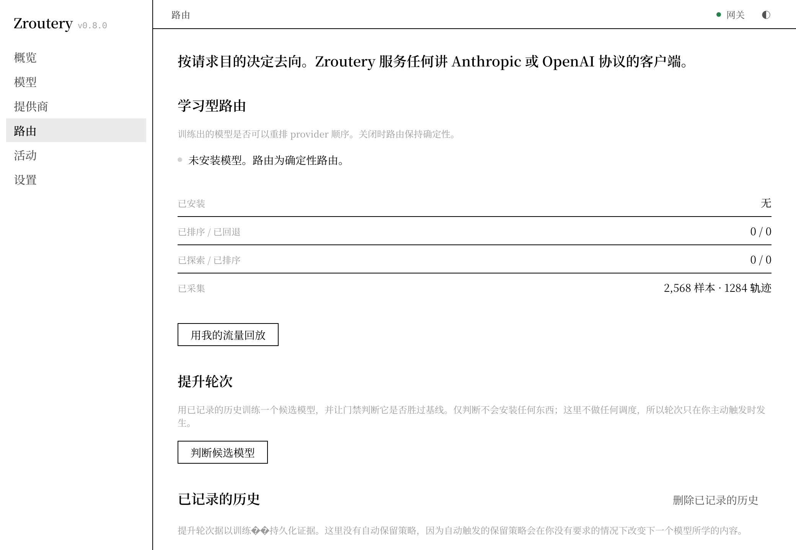

# Zroutery

[English](README.md) | [简体中文](README.zh-CN.md) | 繁體中文

[](https://github.com/hemingtsai/Zroutery/actions/workflows/ci.yml)
[](https://github.com/hemingtsai/Zroutery/actions/workflows/packaging.yml)
[](https://github.com/hemingtsai/Zroutery/releases)
[](https://github.com/hemingtsai/Zroutery)
[](https://github.com/hemingtsai/Zroutery)
[](#平台支援)

Zroutery 是一個本機 LLM 閘道：把多家模型供應商接到同一個本機位址，統一處理協定轉換、路由、預算和用量統計。

客戶端用哪種協定都行——Anthropic、OpenAI Chat、OpenAI Responses、Gemini；Claude Code、Codex、Chatbox 或任意 SDK 指向 `http://127.0.0.1:8787` 即可使用，請求失敗會自動切換到下一個模型。macOS 和 Windows 上是常駐選單列 / 系統匣的桌面應用，也可以不開介面，只跑代理程序。



## 功能

- **多協定**：支援 Anthropic、OpenAI Chat、OpenAI Responses、Gemini 四種客戶端協定；上游目前支援 Anthropic 和 OpenAI 相容兩種。
- **模型分級**：模型分為 fast / standard / reasoning / frontier 四級，客戶端只寫 `standard-class`，由優先順序、路由策略和上游健康狀態決定實際使用的模型。
- **失敗轉移**：依錯誤類型決定重試或切換模型；模型連續失敗會觸發斷路器，斷路期間以半開探測確認恢復，失敗轉移次數和斷路器參數皆可設定。
- **預算控制**：依總量、供應商或層級設定日 / 月上限，超限後可拒絕請求或自動降級到較便宜的層級；帳本落盤，重新啟動不會遺失。
- **金鑰安全**：API key 存入系統憑證庫（macOS 鑰匙串 / Windows 認證管理員），設定檔只保存參照，不出現金鑰本身。唯一例外是供應商的 `extra_headers`：該映射會寫進設定檔，不要把憑證放在那裡。
- **隱私**：請求與回覆本文不落盤，請求記錄只保存中繼資料，上游錯誤本文寫入前會截斷。

## 快速開始

環境：Rust 1.90（Tauri 2.12 要求的最低版本）、Node 22 和 pnpm 11。

```sh
rustup toolchain install 1.90.0
rustup override set 1.90.0     # 選用：固定本目錄的版本
corepack enable                # 提供 pnpm
pnpm install

pnpm dev      # 開發模式
pnpm build    # macOS 產出 .app/.dmg，Windows 產出 .msi 和 NSIS 安裝器
```

桌面版啟動後沒有 Dock 圖示，只有選單列 / 系統匣裡的一份選單：開啟主視窗、啟停閘道、複製位址和 token，退出也在裡面。關掉視窗程式不會退出，代理繼續執行。

不開介面、只跑代理：

```sh
cargo run -p zroutery-headless
```

無介面模式下金鑰從環境變數讀取，例如 `ZROUTERY_KEY_PROVIDER_DEEPSEEK=sk-...`（供應商 `provider:deepseek` 對應這個變數名）。設定目錄用 `ZROUTERY_CONFIG_DIR` 指定；多個實例要共用用量記錄時，讓 `ZROUTERY_RUNTIME_DB` 指向同一個 `runtime.sqlite3`。

## 設定

1. **供應商**頁新增上游：填名稱、協定（OpenAI 相容或 Anthropic）、Base URL，貼上 API key。金鑰直接存入系統憑證庫，不進設定檔。支援從 CC Switch 批次匯入。

   

2. 在供應商詳情裡拉取一次模型目錄，把要用的模型加進來。

3. **模型**頁為每個模型分級。沒有分級的模型仍可以用完整 id 呼叫，只是不參與 `*-class` 路由，頁面會持續提示。層級名稱可以自訂（`fast-class`、`haiku-class`、`luna-class` 都可以），在設定裡修改。

   

4. **路由**頁為每個層級排優先順序，預設按數字，也可以改為依實測延遲和價格選舉；同時設定失敗轉移次數和斷路器參數。排好後頁面依實際嘗試順序顯示每級的候選模型。

   

## 帳戶與簽到

帳戶是供應商上的一份宣告：面板 token、可選的推論金鑰池和維護選項。**供應商**抽屜編輯宣告；**帳戶**頁顯示執行期狀態——最近一次探測、簽到階段，以及排程器為什麼執行或沒有執行。探測是手動的，涵蓋已啟用的帳戶。請求不按帳戶分流：服務路徑每個供應商只解析一份憑證。

簽到有兩條路徑。**HTTP 簽到**使用已儲存的憑證呼叫面板自己的 API，不開瀏覽器。**瀏覽器簽到**用每帳戶獨立的 profile 開啟有頭瀏覽器，並回報目前階段；適用於簽到不是一般 API 呼叫的面板。**Token 擷取**在面板不直接提供持久 token 時產生一個，存入系統憑證庫，並讓帳戶指向它；擷取檢視沒有 token 欄位。

## NewAPI 面板

NewAPI 供應商可以在供應商詳情裡讀取面板：公告、分組價格和帳戶選擇器。讀取面板不會改變路由價格；儲存價格是單獨的模型編輯。面板不可達會被回報為面板錯誤，而不是路由失敗。

## 遷移

遷移把外部客戶端的設定以型別化計畫搬到本閘道：預覽計畫和 fingerprint，執行它，失敗時回復到已擷取的快照。快照在檔案被替換前落盤，因此中斷的執行可以恢復。失敗且沒有快照的遷移不提供回復。

## 接管

接管只把受管的閘道欄位寫進客戶端自己的設定，記錄被替換的值，並在釋放時恢復。**Ready** 顯示欄位級 diff；**conflict** 詢問哪一側獲勝；**degraded** 說明哪些尚未證明；**release** 是破壞性步驟並會要求確認。與遷移不同，接管管理欄位，不替換整個檔案。

## 接上客戶端

閘道預設監聽 `http://127.0.0.1:8787`，連接埠和監聽位址都可以改。四種協定各有入口：

| 客戶端協定 | 入口 |
| --- | --- |
| Anthropic Messages | `POST /v1/messages` |
| OpenAI Chat Completions | `POST /v1/chat/completions` |
| OpenAI Responses | `POST /v1/responses` |
| Gemini generateContent | `POST /v1/generateContent` |

另外有 `GET /v1/models`（列出所有可呼叫的 id）、`GET /v1/status` 和 `GET /health`（唯一不需要驗證的介面）。驗證支援 `x-api-key` 和 `Authorization: Bearer`，token 在「閘道」選單裡複製。

Claude Code：

```sh
export ANTHROPIC_BASE_URL=http://127.0.0.1:8787
export ANTHROPIC_AUTH_TOKEN=<貼上 token>
export ANTHROPIC_MODEL=standard-class
```

OpenAI 系客戶端：

```sh
export OPENAI_BASE_URL=http://127.0.0.1:8787/v1
export OPENAI_API_KEY=<貼上 token>
```

## 資料放在哪

| 內容 | 位置 | 說明 |
| --- | --- | --- |
| 設定 | `config.json`：macOS 在 `~/Library/Application Support/app.zroutery.desktop/`，Windows 在 `%APPDATA%\app.zroutery.desktop\`，可用 `ZROUTERY_CONFIG_DIR` 覆寫 | 不含供應商金鑰；本機閘道 token 和自訂 `extra_headers` 會存在這裡。檔案損壞時先備份一份，再用預設值啟動 |
| API key | 系統憑證庫（macOS 鑰匙串 / Windows 認證管理員） | 設定裡只有 `key_ref` |
| 預算帳本 | 設定目錄下的 `spend.json` | 定時和退出時寫盤 |
| 執行期資料庫 | 設定目錄下的 `runtime.sqlite3`，或 `ZROUTERY_RUNTIME_DB` | 用量歷史、匯入歷史和記帳事實 |
| 學習軌跡 | 設定目錄下的 `ml/traces.jsonl` | 僅在影子評估或已提升模型執行時追加；由操作者明確清空 |
| 請求記錄、健康、延遲統計、Responses 工作階段 | 記憶體 | 有上限，重新啟動清空 |

## 平台支援

- **macOS 11+**：提供 `.app` 和 `.dmg`；常駐選單列；開機啟動透過 LaunchAgent 實現。簽章是 ad-hoc，沒有公證。
- **Windows**：提供 `.msi` 和 NSIS 安裝器；CI 每晚會實際安裝、重新安裝、解除安裝一次安裝器來驗證。
- **Linux**：不是支援的發佈目標。沒有 Linux 打包設定；`src-tauri/Cargo.toml` 中確實包含 Linux 憑證庫相依，因此原始碼建置或許能執行，但未經驗證、也不隨版本發佈。
- **上游**：目前只有 Anthropic 和 OpenAI 相容兩種；Gemini 和 Responses 只能作為客戶端入口協定，還不能作為上游。

## 統計

**活動**頁列出每個請求的入口協定、實際使用的模型、嘗試次數、延遲、token 和花費，並依模型彙總成功率和支出；斷路器計數可以單獨歸零。自動審查產生的側請求單獨統計，不和主流量混在一起。



預算在**設定**頁設定，頁面上同時顯示已用量和限額。

## 學習型路由

桌面建置包含 `ml` 模組，但預設關閉：不採集、不訓練、不影響選路。開啟影子模式後，每個請求會多記錄一筆對照資料（依模型打分會選誰），實際路由不受影響；晉升操作需要在介面上手動觸發。



## 開發

```sh
pnpm test                                 # cargo test --workspace
pnpm smoke                                # 端對端測試（假上游）
pnpm test:layout                          # UI 版面回歸
python3 scripts/ui_interaction_test.py    # UI 互動回歸（假 IPC + 無頭 Chromium）
cargo clippy --workspace --all-features --all-targets -- -D warnings
cargo fmt --all -- --check
```

程式結構：`crates/zroutery-core` 是引擎，不依賴 GUI；`src-tauri` 是桌面外殼（系統匣、憑證庫、CC Switch 匯入）；`crates/zroutery-headless` 是無介面代理，帶 `--elect`、`--balances`、`--experiment` 子命令；`ui/` 是 React 儀表板，支援英文、簡體中文、繁體中文；`scripts/` 存放驗證腳本。

提交訊息依 Conventional Commits 書寫，CI 會逐筆檢查。架構決策和各階段記錄在 `docs/development/`；改程式前先看 `CONTRIBUTING.md` 和 `AGENTS.md`。

## 授權

MIT（見 [LICENSE](LICENSE) 和 `Cargo.toml` 的 `license`）。

## 事實來源

- Rust 最低版本與 Node/pnpm 固定版本：`Cargo.toml::rust-version`、`package.json::packageManager`、`.github/workflows/ci.yml::setup-node`。
- 預設監聽位址、連接埠與請求本文上限：`crates/zroutery-core/src/config/server.rs::ServerConfig`。
- HTTP 路由：`crates/zroutery-core/src/server/handlers.rs::build_app`。
- 打包目標：`src-tauri/tauri.conf.json::bundle`。
- 設定檔與閘道 token：`src-tauri/src/store.rs::FILE_NAME`、`src-tauri/src/store.rs::generate_token`。
- Linux 憑證相依：`src-tauri/Cargo.toml::keyring`。
- 資料位置：`src-tauri/src/platform.rs::default_config_dir`、`crates/zroutery-core/src/runtime_store.rs::RuntimeStore`。

每個重複事實的權威歸屬：[config.md](docs/development/reference/config.md) 負責監聽位址/連接埠，[protocol.md](docs/development/reference/protocol.md) 負責協定，[routing-data.md](docs/development/reference/routing-data.md) 負責資料位置。本指南只是指標；衝突時以 reference 為準。
